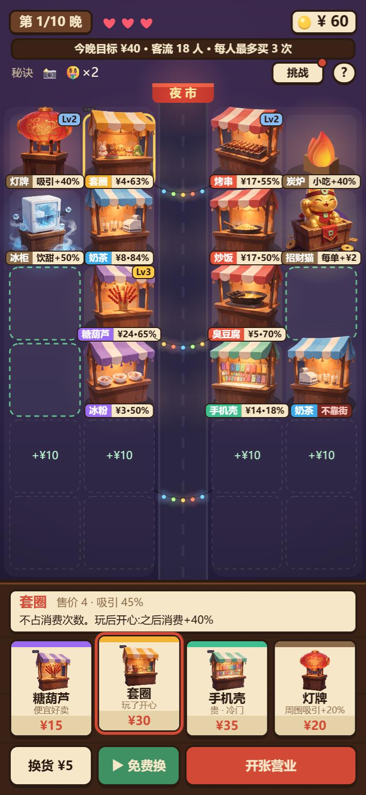

# 夜市一条街

微信小游戏。在一条夜市街上摆摊:顾客从街口走到街尾,路过靠街的摊位会消费,摊位的先后顺序和搭配决定能赚多少。每晚"热度"达标过关(热度 = 当晚流水 × 人气倍数,口渴连击、顾客买满、凑成招牌搭配和"街型"都会涨人气,街型和秘诀可以自由叠加),一晚的客人分三波来,每波之间可以调整摊位。达标后三选一拿"经营秘诀"(最多带 5 种),第 3、6、9、10 晚是提前公布规则的大考,撑过 10 晚通关,之后是无尽模式和更高的难度。另有好友擂台和每日挑战。



## 现状

玩法、界面和工程已完成,在微信开发者工具的模拟器里可以完整游玩。上架前还要做的事(广告位、真机测试、剩余美术、资质)见 [交付说明.md](交付说明.md)。

## 运行

**浏览器调试**:在本文件夹运行下面的命令,然后打开 <http://localhost:8765/night-market-game/index.html>。

```bash
python -m http.server 8765
```

**微信开发者工具**:导入 `night-market-game` 文件夹,选"小游戏"。

## 测试

```bash
node tools/wx_smoke_test.mjs
```

```bash
node tools/monkey_test.mjs
```

前者模拟微信环境走一遍主流程(几秒);后者在五种屏幕下随机操作几千次(十几分钟)。

## 目录

| 位置 | 内容 |
|---|---|
| `night-market-game/` | 游戏工程,导入微信开发者工具的就是它 |
| `tools/` | 美术处理脚本、自动测试、数值校准 |
| `art_raw/` | 美术原图,命名规则见里面的 `说明.txt` |
| `docs/截图/` | 当前版本的界面截图 |
| `archive/` | 早期原型、放弃的等距视角版本、过程截图,仅作记录 |
| `交付说明.md` | 现状、上线前要做的事、怎么调数值、已知不足 |
| `night-market-game/美术规格与出图提示词.md` | 给美术的规格、待办和提示词 |

## 技术说明

不依赖游戏引擎,用画布直接绘制。`night-market-game/js/` 下四个文件:`logic.js` 是规则(不涉及画面),`main.js` 是画面和操作,`art.js` 是摊位和顾客的画法及图片加载,`platform.js` 收拢微信和浏览器的差异。
